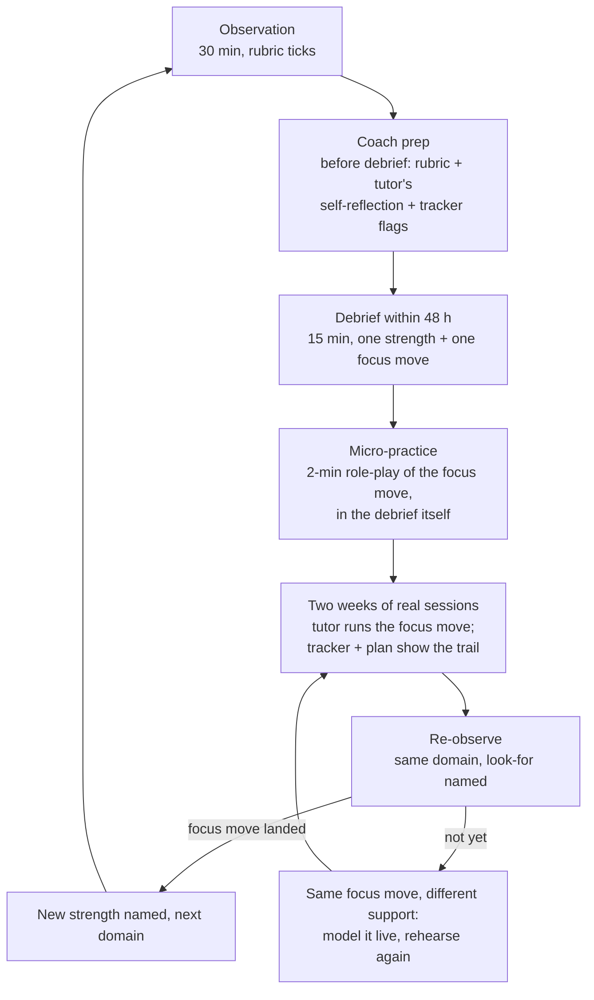

# Coaching cycle

{: .label .label-blue }
Every 2–3 weeks per tutor · 30-minute observation + 15-minute debrief · One strength, one focus move, every cycle

## The cycle

**Text description of the diagram (for screen readers and print):** the cycle is a loop of six steps. (1) The coach observes a 30-minute session, ticking behaviors on the [rubric](observation-rubric.md) print sheet. (2) Before the debrief, the coach reads the rubric notes, the tutor's [self-reflection](/tutor-training-course/tools/tutor-self-reflection.md) and any [tracker](/tutor-training-course/tools/student-progress-tracker.md) flags. (3) Within 48 hours, a 15-minute debrief lands one strength (with evidence) and one focus move — never a list. (4) The focus move is *micro-practiced* in the debrief itself: a two-minute role-play, coach playing a student. (5) Over the following two weeks the tutor runs the focus move in real sessions, leaving a trail in their plans and tracker. (6) The next observation re-looks at the same domain with the look-for named. If the move landed, the coach names a new strength and picks the next domain; if not, the same focus move returns with different support — modeled live, rehearsed again. Then the loop repeats.

## Why the cycle is shaped this way

- **Within 48 hours** — feedback decays fast, and so does the tutor's memory of the moment the focus move should have happened. A debrief a week later is archaeology.
- **One focus move, not five** — the rubric produces five domains; the cycle deliberately takes one. Concentrating on a single move is what makes the next observation a *re-check* rather than a fresh trial, and it matches how the fictional program scores growth (observation 1 → observation 3, target +0.5 average in the [measurement plan](/tutor-training-course/program/measurement-plan.md)).
- **Micro-practice inside the debrief** — the same logic as [live practice sessions](/tutor-training-course/live-practice/): a move not rehearsed is a move not done. Two minutes of role-play ("I'm Desi, I wrote 2x − 4 — go") surfaces the exact wording trouble before the tutor meets a real student with it.
- **The look-for is named at re-observation** — the tutor knows precisely what the next observation will watch for. Surprise observations measure anxiety, not skill.

## Choosing the focus move (the 2-minute rule)

From the rubric sheet, pick the focus by taking the **lowest domain, lowest-stable** — with three overrides:

1. **Data-loop first (Domain 5 ≤ 2):** if the exit-ticket loop is broken, it outranks everything — no data means no other coaching conversation can show effect. [Module 5](/tutor-training-course/modules/5-using-exit-tickets-and-data.md) is the fix.
2. **One mistake away (Domain 3 at 2):** a tutor at "corrects errors outright" is often one probing-question stem away from 3 — highest leverage per week of practice. [Module 3](/tutor-training-course/modules/3-questions-wait-time-and-errors.md) + [Session B](/tutor-training-course/live-practice/session-b.md) materials.
3. **Relationships can't be the first focus** if the tutor is new and struggling with structure — name the warmth as a *strength* (it usually is), focus on structure, and let the relationship behaviors consolidate. New tutors can't work on five fronts, and [T5](/tutor-training-course/transcripts/t5.md) shows warmth surviving every other failure.

## Scheduling inside the fictional program

| Coach load | Cycle cadence | Where it appears |
|---|---|---|
| 1 coordinator : 10 tutors | Observation + debrief = 1 hour per tutor per 2–3 weeks ≈ 4–5 hours/week | [onboarding timeline](/tutor-training-course/program/onboarding-timeline.md) weeks 3+; monthly community-of-practice reviews cycle themes |
| Observation #1 (week 3), #2 (week 6), #3 (week 9) | Growth measured 1 → 3 | [measurement plan](/tutor-training-course/program/measurement-plan.md) tutor-development row |

{: .note }
**Fictional program, real cadence.** The numbers above are the fictional Bridge Math Tutoring's design, but the discipline — 30 minutes, within 48 hours, one move, re-observe — is the transferable content. The [conversation guide](coaching-conversation-guide.md) carries the words; this page carries the clock.
